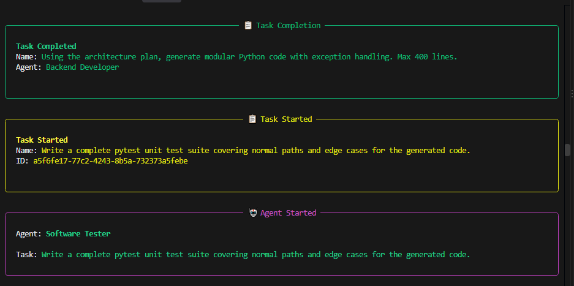
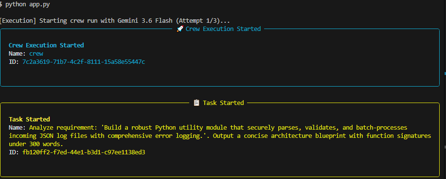
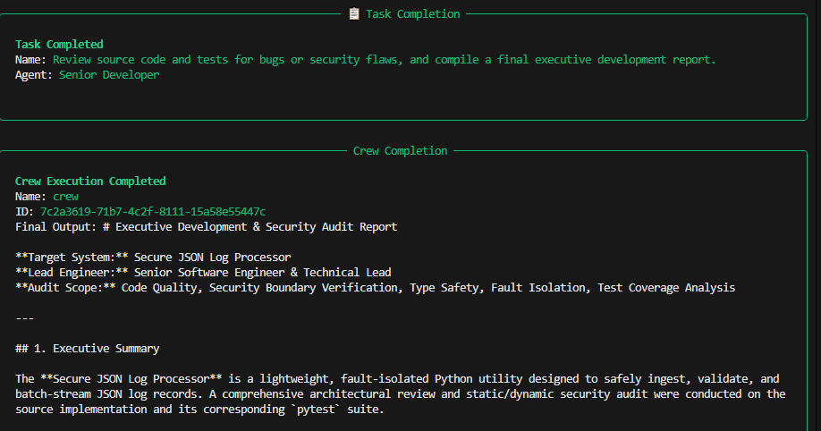

# Multi-Agent Software Development Crew 🤖

An automated multi-agent software development workflow powered by **CrewAI**, **LiteLLM**, and **Gemini 3.6 Flash**. This project simulates a professional engineering team—handling everything from architecture planning and coding to testing and code review—from a single user requirement prompt.

---

## 🚀 Key Features

* **Specialized Agent Roles:** Mimics a real-world software team using structured agents (Software Architect, Backend Developer, QA Engineer, Senior Developer).
* **API Key Rotation:** Built-in multi-key fallback/rotation logic (`GEMINI_API_KEY_1`, `GEMINI_API_KEY_2`) to prevent rate limits and quota exhaustion.
* **Resilient Execution:** Implements retry-enabled execution loops with exponential backoff delays (`time.sleep()`) to gracefully handle temporary service drops or rate-limit spikes.
* **Token Efficiency:** Narrowly scoped agent task descriptions to minimize token consumption and maintain high output quality.
* **Clean Artifact Delivery:** Automatically saves all agent outputs directly to disk (`architecture_plan.md`, `generated_code.py`, `test_code.py`, `development_report.md`).

---

## 📂 Project Structure

```text
Multi-Agents/
│
├── venv/                  # Python virtual environment
├── app.py                 # Main multi-agent pipeline script
├── .env                   # Environment variables (API keys)
├── .env.example           # Example environment template
├── .gitignore             # Git ignore rules
└── requirements.txt       # Project dependencies
```

---

## ⚙️ Setup & Installation

### 1. Clone or Open the Project
Clone repo https://github.com/MaryamArif85/multi-agent-sdlc-Software-Development-Life-Cycle-

### 2. Activate the Virtual Environment
* **Windows (Command Prompt / PowerShell):**
  ```bash
  venv\Scripts\activate
  ```
* **macOS / Linux:**
  ```bash
  source venv/bin/activate
  ```

### 3. Install Dependencies
Install the required packages including CrewAI and the Google Gen AI provider extension:
```bash
pip install -r requirements.txt
pip install "crewai[google-genai]"
```

### 4. Configure Environment Variables
Create or update your `.env` file in the root directory and add your Gemini API keys:
```env
GEMINI_API_KEY_1=your_first_gemini_api_key_here
GEMINI_API_KEY_2=your_second_gemini_api_key_here
```

---

## 💻 Usage

Run the main application script:
```bash
python app.py
```

When prompted, type or paste your software requirement or task description in the terminal:
```text
============================================================
🤖 MULTI-AGENT SOFTWARE DEVELOPMENT CREW (Powered by Gemini 3.6 Flash)
============================================================

Enter your software requirement or task description:
> Build a robust Python utility module that securely parses and validates incoming JSON logs.
```

Once execution completes, check your root directory for the generated artifacts:
1. `architecture_plan.md` — Technical specification and function signatures.
2. `generated_code.py` — Modular Python backend implementation.
3. `test_code.py` — Pytest unit test suite covering edge cases.
4. `development_report.md` — Final executive code review and summary.

## 📸 Visual Demonstration

### 1. Workflow Pipeline


### 2. Execution Phase


### 3. Successful Completion & Artifact Delivery
